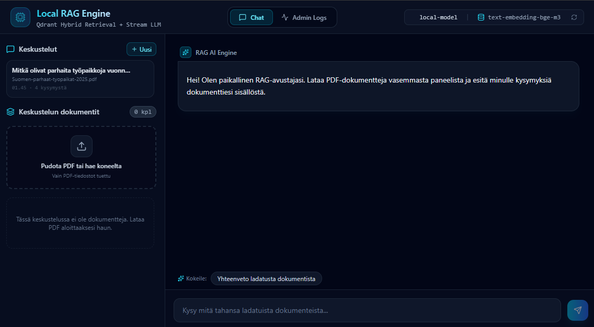
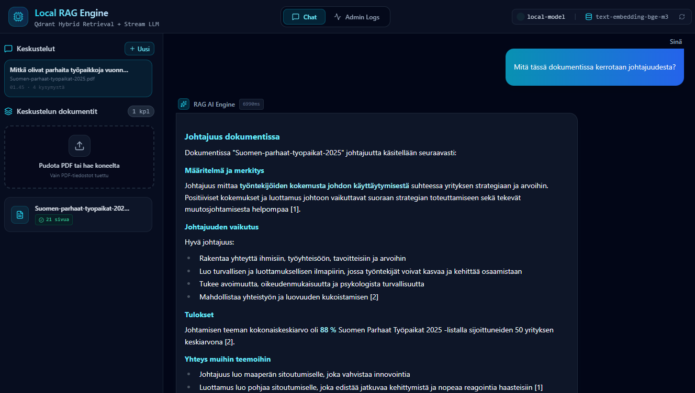

# Local RAG (Retrieval-Augmented Generation) Engine
🇬🇧 [English](README-ENG.md) · 🇫🇮 [SUOMI](README.md)

RAG (Retrieval-Augmented Generation) on arkkitehtuuri, jossa paikallinen kielimalli (LLM) hakee reaaliaikaisesti ja tietoturvallisesti faktoja yrityksen omista dokumenteista sekä muodostaa vastauksen paikallisesti ilman internet-yhteyksiä, tai muita maksuja lataamiesi tietojen pohjalta.

Unohda tokenit ja esitä kysymyksiä omista PDF-dokumenteistasi ja saa vastaukset lähdeviitteineen niin, että kaikki dokumentit, upotukset ja kehotteet pysyvät omalla laitteistollasi.

> **"Tietosuoja on suurin yksittäinen este tekoälyn käyttöönotolle yrityksissä Euroopassa ja Suomessa."**
> Yritysten on hallittava, suojattava ja omistettava datansa täysin itse. **Local RAG Engine** vastaa tähän haasteeseen: se on täysin paikallinen RAG-alusta (Retrieval-Augmented Generation) ilman pilvirajapintoja, telemetriaa tai internetyhteyden tarvetta ajon aikana.


Kuvakaappaus: Käyttöliitymän ulkoasu (localhost).

## 🎯 Motivaatio: miksi paikallinen RAG?

Pilvipohjaiset LLM-rajapinnat ovat nopeita ottaa käyttöön, mutta eurooppalaiset yritykset, julkishallinto sekä juridiset ja rahoitusalan organisaatiot kohtaavat GDPR-velvoitteita, vaatimustenmukaisuuden haasteita ja IP-vuotojen riskejä, kun sisäisiä dokumentteja lähetetään ulkoisiin palveluihin.

Tämä projekti osoittaa, että **omaa dataa ei tarvitse lähettää kolmannen osapuolen palveluun, jotta voi rakentaa modernin tekoälyavustajan.** Paikallisilla malleilla, vektoritietokannalla ja hybridihaulla organisaatio pitää datansa omalla laitteistollaan tai yksityisessä infrastruktuurissaan.

---

## 💡 Keskeiset käyttökohteet

* **⚖️ Juridiikka & Vaatimustenmukaisuus:** Käsittele luottamuksellisia sopimuksia ja juridisia dokumentteja ilman tietovuotoriskejä tai ulkopuolisia rajapintoja.
* **🏥 Terveydenhuolto & Tutkimus:** Hae suoraan kliinisestä dokumentaatiosta ja sisäisistä ohjeista potilastietosuojan ja tiukkojen säädösten mukaisesti omassa ympäristössä.
* **💰 Talous & Tilintarkastus:** Analysoi sisäisiä raportteja, dokumentteja ilman, että arkaluonteiset luvut tai taloustiedot poistuvat yrityksen omilta laitteilta.
* **🏛️ Julkinen sektori & Air-gapped-ympäristöt:** Käsittele rajoitettua materiaalia täysin eristetyissä verkoissa, joissa ei ole lainkaan internet-yhteyttä.
* **🛠️ Tekninen tietopankki & Kehitys:** Anna kehitystiimien hakea tietoa spesifikaatioista, sisäisistä wikidokumenteista ja teknisistä PDF-oppaista turvallisesti ja paikallisesti.

---

## ✨ Ominaisuudet

- 🛡️ **Paikallinen ensin:** upotukset, haku ja LLM-päättely toimivat omalla koneellasi tai yksityisellä palvelimellasi. Kun kontit on rakennettu, internetyhteyttä ei tarvita.
- 🔍 **Hybridihaku:** tiheät upotukset (`bge-m3` LM Studion kautta) yhdistettynä harvaan BM25-avainsanahakuun (`fastembed`) Qdrantissa. Monikielinen: suomenkieliset, englanninkieliset ja ruotsinkieliset dokumentit.
- ⚡ **Vastausten suoratoisto SSE:llä:** lähteet saapuvat ensin, sitten tokenit. Päättelymallit toimivat, koska `<think>...</think>`-lohkot poistetaan palvelimella (`STRIP_THINK`).
- 🗂️ **Keskusteluhistoria:** jokainen keskustelu säilyttää viestit, lähteet ja dokumentit. Aiemmat keskustelut voi avata sivupalkista, ja ne säilyvät uudelleenkäynnistyksissä.
- 🏷️ **Eristetyt keskustelukontekstit:** jokainen keskustelu omistaa omat PDF-tiedostonsa. Haku rajataan Qdrantissa `conversation_id`:llä, joten dokumentit eivät vuoda keskustelusta toiseen.
- 💬 **Ehdotetut kysymykset:** latauksen jälkeen LLM luo muutaman esimerkkikysymyksen dokumentin kielellä. "Yhteenveto"-oikotie on aina käytettävissä.
- 📑 **Rikas Markdown-esitys:** otsikot, listat, lihavoinnit, GitHub-tyyliset taulukot (vaakasuunnassa vieritettävässä kontissa) sekä `[n]`-viitteet laajennettavine lähdeotteineen.
- 📊 **Admin-lokinäkymä:** tarkastele hakuviiveitä, pistemääriä ja aiempien kyselyjen tarkkoja lähteitä. Avaa mikä tahansa lokirivi nähdäksesi koko vastauksen tai siirtyäksesi sen keskusteluun.

> Käyttöliittymä on tällä hetkellä suomeksi.


Kuvakaappaus: Käyttöliitymän toiminnallisuuden esittäminen (localhost).
## 🛠️ Arkkitehtuuri

```text
┌───────────────────────────────────────────────────────────────┐
│                           SELAIN                              │
│     React + TypeScript + Tailwind CSS (Nginx tarjoilee)       │
└───────────────────────────────┬───────────────────────────────┘
                                │ HTTP / SSE-virta  (/api/*)
                                ▼
┌───────────────────────────────────────────────────────────────┐
│                       FASTAPI-BACKEND                         │
│  Keskustelut · ingestio · haku · suoratoisto · lokit          │
│  Tilatiedosto (state.json): dokumentit + keskustelut          │
└───────────────┬───────────────────────────────┬───────────────┘
                │ tiheä + harva haku            │ chat + upotukset
                ▼                               ▼
┌───────────────────────────┐   ┌───────────────────────────────┐
│          QDRANT           │   │          LM STUDIO            │
│  Vektori + BM25-hybridi-  │   │  OpenAI-yhteensopiva palvelin │
│  indeksi (Docker)         │   │  isäntäkoneella               │
└───────────────────────────┘   └───────────────────────────────┘
```

**Datavirta**

- **Lataus:** PDF → API (`202 Accepted`) → ingestio taustalla → pilkonta → tiheä upotus (LM Studio) + harva BM25 (fastembed) → Qdrant, merkittynä tunnisteilla `doc_id` ja `conversation_id`.
- **Kysely:** kysymys + `conversation_id` → hybridihaku rajattuna kyseisen keskustelun dokumentteihin → numeroitu kontekstikehote → LM Studio → SSE-virta (lähteet, tokenit, valmis). Vuorovaikutus tallennetaan keskusteluhistoriaan.

**Teknologiat**

| Kerros | Teknologia |
|---|---|
| Frontend | React, TypeScript, Vite, Tailwind CSS, Lucide-ikonit, `react-markdown` + `remark-gfm` |
| Backend | Python, FastAPI, LlamaIndex, Uvicorn |
| Vektoritietokanta | Qdrant (Docker) |
| Harva indeksi | FastEmbed BM25 (malli sisällytetty konttikuvaan) |
| LLM / upotukset | LM Studio tai mikä tahansa OpenAI-yhteensopiva palvelin (vLLM, llama.cpp server, ...) |
| Käyttöönotto | Docker Compose, Nginx-käänteisproxy (SSE-puskurointi pois päältä) |

Lisätietoja ja päätösloki löytyvät tiedostosta [ARCHITECTURE.md](ARCHITECTURE.md).

---

## 🚀 Pika-aloitus

### Vaatimukset

1. **Docker** ja **Docker Compose**.
2. **LM Studio** käynnissä isäntäkoneella:
   - Lataa upotusmalli, esim. `text-embedding-bge-m3`.
   - Lataa keskustelumalli, esim. Qwen 2.5 Instruct -malli.
   - Käynnistä paikallinen palvelin (oletuksena `http://localhost:1234/v1`).

   Linuxissa varmista, että LM Studion palvelin on tavoitettavissa Docker-konteista (ei sidottu pelkästään osoitteeseen `127.0.0.1`). Compose-tiedosto yhdistää `host.docker.internal`-nimen isäntäkoneeseen.

### Käynnistys Docker Composella

```bash
git clone https://github.com/your-username/local-rag-engine.git
cd local-rag-engine

# Tarkista backend-palvelun environment-osio tiedostossa docker-compose.yml
# (LLM_BASE_URL, LLM_MODEL, EMBED_MODEL) ja muokkaa se LM Studio -asetuksiisi sopivaksi.

docker compose up -d --build
```

Avaa **http://localhost:3000**. Qdrantin hallintapaneeli on osoitteessa http://localhost:6333/dashboard ja API osoitteessa http://localhost:8000/docs.

Luo keskustelu lataamalla PDF tai esittämällä kysymys, ja kysy sitten dokumentista.

### Paikallinen kehitys (sovellus ilman Dockeria)

```bash
# 1. Qdrant
docker compose up -d qdrant

# 2. Backend (Python 3.11+)
cd backend
pip install -r requirements.txt
QDRANT_URL=http://localhost:6333 UPLOAD_DIR=./data/uploads \
  uvicorn app:app --reload --port 8000

# 3. Frontend
cd frontend
npm install
npm run dev        # http://localhost:5173, /api ohjataan porttiin 8000
```

---

## ⚙️ Asetukset

Kaikki asetukset ovat backend-palvelun ympäristömuuttujia (aseta ne tiedostossa `docker-compose.yml`).

| Muuttuja | Oletus | Kuvaus |
|---|---|---|
| `LLM_BASE_URL` | `http://host.docker.internal:1234/v1` | OpenAI-yhteensopiva rajapinta chatille ja upotuksille |
| `LLM_API_KEY` | `lm-studio` | Rajapinnalle lähetettävä API-avain (LM Studiolle käy mikä tahansa) |
| `LLM_MODEL` | `local-model` | Keskustelumallin tunniste |
| `EMBED_MODEL` | `text-embedding-bge-m3` | Upotusmallin tunniste |
| `QDRANT_URL` | `http://qdrant:6333` | Qdrantin osoite |
| `COLLECTION` | `documents` | Qdrant-kokoelman nimi |
| `TOP_K`, `HYBRID_TOP_K` | `5`, `5` | Haettavien pätkien määrä (tiheä/harva haku sekä yhdistämisen jälkeen) |
| `TEMPERATURE` | `0.1` | LLM:n lämpötila |
| `STRIP_THINK` | `true` | Poista `<think>`-lohkot suoratoistetuista vastauksista |
| `UPLOAD_DIR` | `/data/uploads` | Ladattujen PDF-tiedostojen sijainti |
| `STATE_PATH` | `<UPLOAD_DIR>/state.json` | Tallennetut dokumentit ja keskustelut |
| `MAX_LOG_ENTRIES` | `500` | Muistissa säilytettävien hakulokien määrä |

Data tallentuu kahteen Docker-volumeen: `qdrant_data` (vektorit) sekä `rag_data` (PDF-tiedostot ja `state.json`).

---

## 📡 API-yleiskatsaus

| Rajapinta | Metodi | Tarkoitus |
|---|---|---|
| `/api/conversations` | `POST` / `GET` | Luo keskustelu / listaa keskustelut (uusin ensin) |
| `/api/conversations/{id}` | `GET` / `DELETE` | Hae keskustelu viesteineen ja dokumentteineen / poista se dokumentteineen, tiedostoineen ja vektoreineen |
| `/api/conversations/{id}/documents` | `POST` / `GET` | Lataa PDF (asynkroninen ingestio, `202`) / listaa keskustelun dokumentit ja niiden tila |
| `/api/documents/{doc_id}` | `DELETE` | Poista yksi dokumentti (tiedosto, vektorit, tilamerkintä) |
| `/api/query` | `POST` | Hybridihaku keskustelun dokumenteista, suoratoisto SSE:llä (`sources`, `token`, `done`, `error`) |
| `/api/admin/search-logs` | `GET` | Viimeiset 100 kyselyä: pistemäärät, hakuviive |
| `/api/admin/search-logs/{id}` | `GET` | Koko lokirivi: kysymys, vastaus, lähteet, ajat |
| `/api/health` | `GET` | Mallien nimet, LLM:n osoite, dokumenttien määrä |

FastAPI tarjoaa interaktiivisen API-dokumentaation osoitteessa `/docs` portissa 8000.

---

## 🛡️ Tietoturvaraja ja tuotantokäyttö

- **Verkkoraja:** Qdrant ja backend keskustelevat vain Dockerin sisäisessä verkossa, ja backend kutsuu vain paikallista LM Studio -palvelinta. Internetyhteyttä ei tarvita kuvien rakentamisen jälkeen.
- **Ei autentikointia vielä:** kaikki rajapinnat, myös `/api/admin/*`, ovat avoimia. Hakulokit ja keskusteluhistoria sisältävät dokumenttien tekstiä ja kokonaisia vastauksia. Luotetun verkon ulkopuolella sovelluksen eteen kannattaa laittaa autentikointiproxy (esim. OAuth2-Proxy tai Authelia) tai lisätä rajapintaan pääsynhallinta.
- **Tilan tallennus:** dokumentit ja keskustelut ovat yhdessä JSON-tiedostossa, ja hakulokit ovat muistissa. Tämä riittää yhden käyttäjän käyttöön; monen käyttäjän ympäristöön tarvitaan tietokanta.
- **Ingestio taustalla:** se ajetaan samassa prosessissa eikä säily uudelleenkäynnistyksen yli (keskeytyneet lataukset merkitään epäonnistuneiksi). Tuotannossa käytä työjonoa, kuten Celery + Redis.

---

## 🛣️ Tiekartta

- [ ] Siirrä tila tiedostosta `state.json` PostgreSQL:ään tai SQLiteen ja tallenna hakulokit pysyvästi
- [ ] Monivuoroinen muisti: lähetä viimeisimmät vuorot LLM:lle ja kirjoita jatkokysymykset itsenäisiksi hakukyselyiksi
- [ ] Cross-encoder-uudelleenjärjestys (esim. `bge-reranker`) hybridihaun parhaille osumille
- [ ] Klikattavat `[n]`-viitteet ja PDF-katselin siteeratulle sivulle
- [ ] Dokumentin uudelleenkäyttö useassa keskustelussa
- [ ] Autentikointi ja roolipohjainen käyttöoikeuksien hallinta (RBAC) dokumenttikohtaisin oikeuksin
- [ ] Arviointiaineisto (50 kysymys–vastaus-paria) hakutarkkuuden ja vastausten uskollisuuden mittaamiseen
- [ ] Pistekynnys, jotta heikko konteksti johtaa vastaukseen "En tiedä"

---

## 📄 Lisenssi

Tämä projekti on lisensoitu MIT-lisenssillä. Katso [LICENSE](LICENSE).
